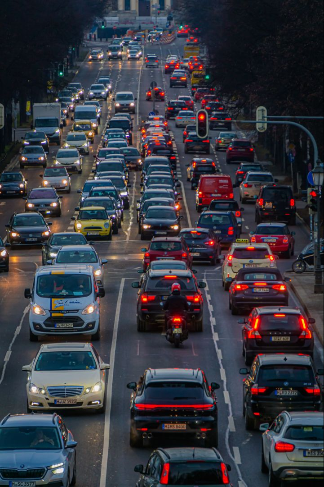
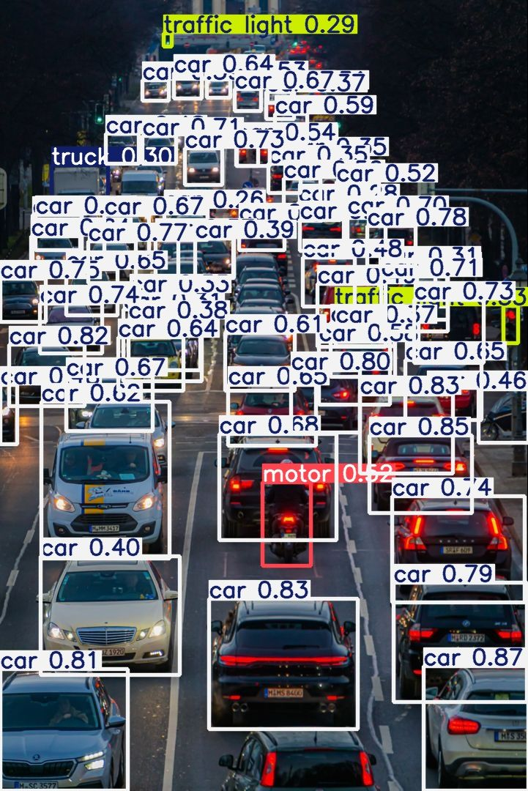

# Vehicle Detection Model

This project is a vehicle detection model trained to detect different types of vehicles from images and videos. The model can identify vehicles such as cars, buses, trucks, motorcycles and other objects depending on the classes included in the training dataset.

The main purpose of this project is to detect vehicles automatically and draw bounding boxes around the detected objects. The trained model can be used with both images and video.

## Sample Results

### Before Detection

This is an example image before applying the trained model.



### After Detection

The same type of input after being processed by the trained model.



### Video Result

The following video shows the trained model detecting vehicles from a video:

<video src="after.mp4" controls></video>

If the video preview does not appear on GitHub, the video can be downloaded and played locally.

## About the Model

The model was trained using the YOLO object detection architecture. YOLO was used because it can detect objects in an image while also providing their location through bounding boxes.

The dataset used for training contains images with annotated objects. Each object has a class label and its bounding box coordinates. The annotations were converted into the format required by YOLO.

The model was trained on a GPU to reduce the training time. During training, the model learned to recognize the visual features of different vehicle classes from the training images.

## Dataset

The training dataset contains images of road and traffic scenes with different types of objects.

The classes used in the dataset include:

* Person
* Rider
* Car
* Bus
* Truck
* Bike
* Motor
* Traffic Light
* Traffic Sign
* Train

For this project, the vehicle-related classes are the main focus.

The dataset was divided into training and validation data. The training data was used to teach the model, while the validation data was used to check how well the model performed on images it had not directly trained on.

## Training

The model was trained using the YOLO training framework.

The training process started with a pretrained YOLO model and then continued training it using the vehicle detection dataset. Using a pretrained model helps the network learn faster because it already has some basic knowledge of visual features such as edges, shapes and textures.

The images were resized to the required input size before being given to the model. During training, the model adjusted its parameters based on the difference between the predicted bounding boxes/classes and the actual annotations.

The main training configuration used was:

```text
Model: YOLO11
Image Size: 640 × 640
Batch Size: 8
GPU: NVIDIA RTX 2050
Epochs: 100
```

The model was trained using CUDA-enabled GPU acceleration.

## How Detection Works

When an image or video frame is given to the model, YOLO processes the image and looks for objects that belong to the classes it learned during training.

For every detected object, the model provides:

* The object class
* The confidence score
* The position of the object

A bounding box is then drawn around the detected object. For video detection, this process is repeated for each frame of the video.

The basic flow is:

```text
Input Image / Video
        ↓
Image Preprocessing
        ↓
YOLO Detection Model
        ↓
Object Detection
        ↓
Class + Confidence + Bounding Box
        ↓
Output Image / Video
```

## Model Evaluation

The model was evaluated using the validation dataset. The main metrics used during training were precision, recall, mAP50 and mAP50-95.

**Precision** shows how many of the objects detected by the model were actually correct.

**Recall** shows how many of the actual objects in the images were successfully detected.

**mAP50** measures detection performance using an IoU threshold of 0.50.

**mAP50-95** measures performance over multiple IoU thresholds from 0.50 to 0.95, giving a stricter measure of detection accuracy.

These metrics were monitored during training to see how the model improved over the training epochs.

## Running the Model

After training, the best model weights can be used to detect vehicles on new images or videos.

For an image, the model takes the image as input and produces a new image containing the detected objects and their bounding boxes.

For a video, each frame is processed and the resulting frames are combined to create the output video.

The trained model weights can be loaded using the YOLO framework and used for prediction.

Example:

```python
from ultralytics import YOLO

model = YOLO("best.pt")

results = model("test.jpg", save=True)
```

For video detection:

```python
results = model("input.mp4", save=True)
``` 

## Result

The trained model is able to detect vehicles and other objects included in the training dataset. The sample image and video above show the output produced after applying the trained model to previously unseen input.

The model can be further improved by using a larger and more diverse dataset, better annotations, additional training, and images that are closer to the actual road conditions where the system will be used.
